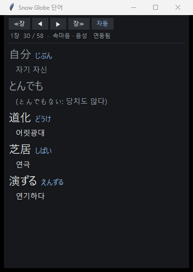
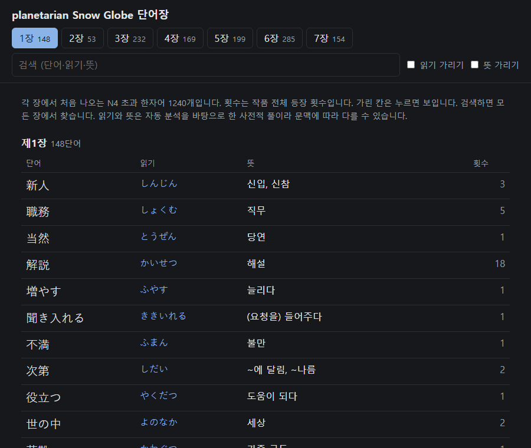

# vn-study-kit

> **English summary** — A Claude Code skill that turns a Japanese visual novel you own into study material: it adds furigana to every kanji in the game script, builds a small always-on-top window that follows the line on screen and shows each word's reading and meaning, and generates per-chapter vocabulary sheets. Glosses and UI can be in your language (Korean, English and Japanese UI strings are built in; Claude writes the glosses in the language you choose). Windows + Python only, no text-hooking tools. It never ships game files and does not translate the script. The rest of this README is in Korean.

일본어 비주얼 노벨을 **일본어 공부용**으로 바꿔 주는 Claude Code 스킬입니다.
한글패치가 없는 게임을 일본어 그대로 플레이하면서, 읽기와 단어 뜻을 바로 확인할 수 있게 합니다.

Claude Code에게 게임 폴더를 열어 주고 `/vn-study-kit`이라고 하면, 아래 세 가지를 그 게임에 맞춰 만들어 줍니다.

## 만들어 주는 것

### 1. 후리가나 패치
게임 스크립트의 모든 한자에 후리가나(루비)를 넣습니다. 형태소 분석기로 읽기를 자동으로 붙이고, 틀리기 쉬운 읽기는 검수해서 고칩니다.

### 2. 따라오는 단어 창
게임 옆에 띄워 두는 작은 창입니다. 대사를 넘기면 **지금 화면에 나온 줄의 단어만** 읽기와 뜻으로 보여 줍니다.
기초 단어(N4·N5)는 회색, 그보다 어려운 단어는 흰색으로 구분됩니다.



- 별도 후킹 프로그램(Textractor 등)을 설치하지 않습니다. 실행 중인 게임의 메모리를 읽기 전용으로 읽습니다.
- ◀ ▶ 버튼으로 직접 넘겨 볼 수도 있습니다.

### 3. 장별 단어장
복습용 단어장 페이지와 Anki용 파일입니다. 장별 탭, 검색, 읽기/뜻 가리기 기능이 있습니다.



## 필요한 것

- Windows
- Python 3.10 이상 (`pythonw`가 PATH에 있어야 함)
- [Claude Code](https://claude.com/claude-code)
- 직접 구입해 설치한 게임

분석기(`fugashi`, `unidic-lite`)와 `numpy`, `Pillow`는 작업 중에 Claude가 `pip`로 설치합니다.

## 설치

Claude Code의 스킬 폴더에 이 저장소를 그대로 받습니다.

```
git clone https://github.com/hione0413/vn-study-kit "%USERPROFILE%\.claude\skills\vn-study-kit"
```

Claude Code를 다시 시작하면 `/vn-study-kit`이 목록에 나타납니다.

## 사용법

1. 게임 설치 폴더에서 Claude Code를 엽니다.
2. `/vn-study-kit`을 입력하거나 "이 게임에 후리가나랑 단어 창 만들어줘"라고 말합니다.
3. 단어 창 연동 단계에서는 게임을 켜서 대사가 떠 있는 상태로 두라는 안내가 나옵니다.
4. 끝나면 게임 폴더의 `study` 폴더에 있는 `단어창 실행.bat`을 더블클릭해 사용합니다.

## 언어 선택

뜻풀이와 화면 문구의 언어를 고를 수 있습니다. 작업을 시작할 때 Claude가 어떤 언어로 만들지 물어봅니다.

- **뜻풀이**: 고른 언어로 Claude가 게임마다 새로 씁니다. 어떤 언어든 가능합니다.
- **화면 문구**(단어 창의 버튼·상태 표시, 단어장 페이지): 한국어, 영어, 일본어가 들어 있습니다. 다른 언어는 `scripts/i18n.py`에 표를 하나 추가하면 되고, 빠진 항목은 영어로 표시됩니다.
- 선택한 언어는 게임의 `study\config.json`에 저장됩니다. 예: `{"lang": "en", "game": "Game Title"}`

영어와 일본어 화면은 단어장 페이지 생성까지 확인했고, 실제 게임에서 끝까지 써 본 것은 한국어뿐입니다.

## 지원 범위

| 게임 | 상태 |
|---|---|
| planetarian Snow Globe (Steam) | 전체 동작 확인 |
| 같은 엔진 계열(스크립트가 `SCRIPT.PAK`, 이미지가 `CZ` 형식인 게임) | 코드 대부분 재사용 가능. 대사 명령 형식과 현재 줄 위치는 게임마다 다시 확인 필요 |
| 다른 엔진 | 스크립트 해석과 현재 줄 찾기를 새로 해야 함. 후리가나 문법이 없는 엔진은 단어 창만 가능 |

게임마다 달라지는 부분과 그대로 쓰는 부분, 작업 중 겪은 함정은 [SKILL.md](SKILL.md)에 정리되어 있습니다.

## 들어 있는 파일

| 경로 | 내용 |
|---|---|
| `SKILL.md` | Claude가 따라 하는 작업 순서와 주의점 |
| `scripts/furi.py` | 스크립트 해석, 후리가나 삽입, 다시 묶기 |
| `scripts/verify.py` | 패치 후 원문이 그대로인지 검증 |
| `scripts/vocab.py`, `scripts/sheet.py` | 단어 추출, 단어장 페이지와 Anki 파일 생성 |
| `scripts/wordwin.py`, `scripts/wordwin_ui.py` | 단어 창 |
| `scripts/i18n.py` | 언어별 화면 문구와 뜻풀이 파일 선택 |
| `scripts/memscan.py` | 게임 메모리 읽기 전용 도우미 |
| `scripts/explore_*.py` | 새 게임에서 현재 줄 위치를 찾는 탐색 도구 |
| `examples/snow-globe/` | Snow Globe용 단어 뜻풀이와 읽기 수정 목록 |

## 알아 둘 점

- **게임 파일은 들어 있지 않습니다.** 이 스킬은 사용자가 가진 게임 파일을 그 자리에서 수정할 뿐이고, 원본은 `.orig`로 백업합니다. 패치된 게임 파일을 배포하지 마세요.
- **번역 패치가 아닙니다.** 대본을 번역하지 않고, 후리가나와 사전식 단어 뜻풀이만 만듭니다.
- 자동으로 붙인 읽기는 일부 틀릴 수 있습니다. 음성이 있는 대사에서 다르게 들리면 `overrides.py`에 추가해 고칩니다.
- Steam 업데이트나 무결성 검사를 하면 후리가나 패치가 사라집니다. 게임이 업데이트되면 단어 창 연동 위치도 다시 찾아야 할 수 있습니다.
- N5/N4 단어 구분에는 공개 JLPT 단어 목록을 내려받아 씁니다. 목록 자체는 이 저장소에 넣지 않았습니다.
- 스크린샷은 이 도구의 화면만 실었습니다. 게임 화면은 넣지 않았습니다.

## 라이선스

[MIT](LICENSE)
